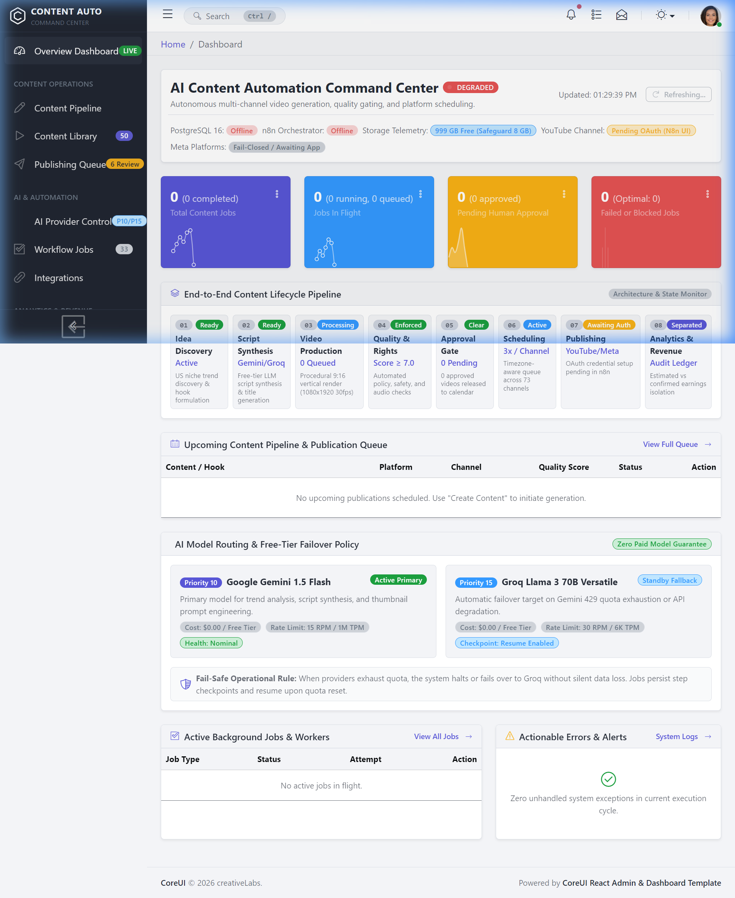
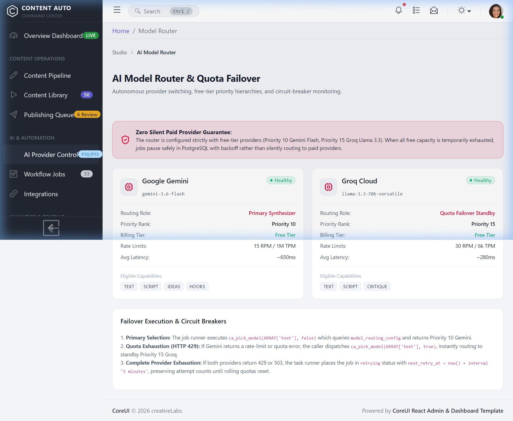
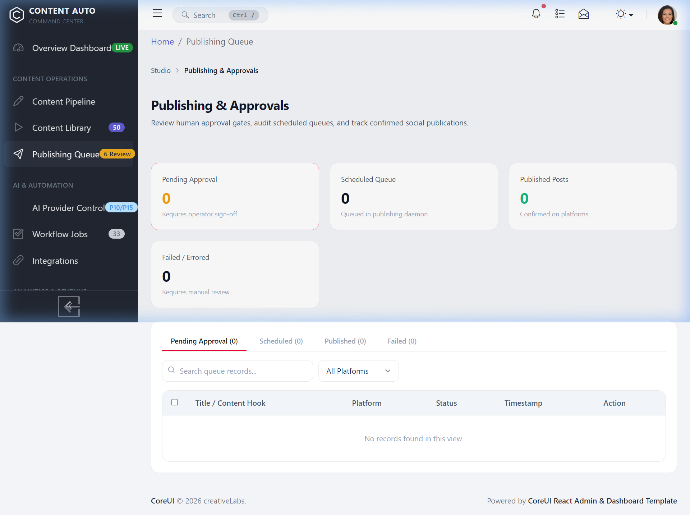

# Content Automation Platform (CAP)

> **Autonomous Multi-Platform Short-Form Video Pipeline • 16 Modular n8n Workflows • CoreUI React Operations Dashboard • PostgreSQL State Engine • Fail-Closed Resilience**

[](https://yatinjoshi05.github.io/content-automation-platform/)
[](https://portfolio-yatin-portfolio1.vercel.app/)
[](https://docs.n8n.io/)
[](https://www.postgresql.org/)
[](https://nodejs.org/)
[](https://www.linkedin.com/in/yatin-joshi-86a814363/)
[](https://portfolio-yatin-portfolio1.vercel.app/)

---

## 1. System Overview

**Content Automation Platform (CAP)** is an enterprise-grade, event-driven short-form video generation, quality audit, and cross-platform publishing engine designed for high-throughput social channels (YouTube Shorts, Instagram Reels, Facebook Reels).

Unlike monolithic single-workflow automation scripts that crash under rate limits, API drops, or quota exhaustion, CAP divides the content lifecycle into **16 decoupled, idempotent state machines** backed by transactional PostgreSQL locks, circuit-breaker model failover, and strict human-in-the-loop approval gates.



---

## 2. Key Architecture Pillars

### A. 16 Decoupled n8n Workflows
Every stage of the production pipeline operates independently through database-backed lease queues (`ca_claim_job()` with skip-locked concurrency):
1. **Master Orchestrator:** Scheduled cadence manager and health sentinel.
2. **Trend Research:** Aggregates topic velocity and search volume into candidate niches.
3. **Source Discovery:** Scrapes rights-cleared candidate videos from approved creator channels.
4. **Rights Verification:** Validates commercial licensing and creative attribution requirements.
5. **Monetization & Policy Audit:** Automated LLM policy check for advertiser friendliness.
6. **Clipping Worker:** Dispatches video segment cutting to local FFmpeg/OpenShorts.
7. **Content Packaging:** Generates viral vertical titles, descriptions, hashtags, and SRT subtitles.
8. **Approval Queue:** Human-in-the-loop review interface for staged video drafts.
9. **Scheduler:** Optimizes multi-channel posting windows and staggered distribution.
10. **Publishing Adapter:** Fail-closed YouTube Data API v3 and Meta Reels publishing adapter.
11. **Performance Analytics:** Ingests view counts, retention graphs, and ad earnings.
12. **Supervisor Sentinel:** Detects stuck jobs, deadlocks, and stale execution leases.
13. **Global Error Handler:** Centralized incident classifier and error logging.
14. **Operational Notifications:** Important-only alert pipeline with deduplication.
15. **Visual Technical QA:** Automated video inspection (black frames, freezes, 9:16 aspect ratio).
16. **Original Content Generator:** 100% procedural first-party video synthesis (SAPI TTS + FFmpeg).

### B. Fail-Closed Reliability & Quota Resilience
* **Multi-Provider AI Fallback:** Primary generation routes through free-tier Groq (`qwen3.8-27b`, `gpt-oss-120b`) with zero-overhead failover to Google Gemini (`gemini-2.5-flash`) on HTTP 429/503.
* **Leased Half-Open Probe Recovery:** Automatically recovers tripped model circuit breakers without system restarts.
* **Ambiguous Timeout Safety:** If a network timeout occurs during YouTube byte upload, publication is categorized as `AMBIGUOUS` rather than retried immediately, mathematically eliminating duplicate uploads.
* **Disk Space Telemetry:** Background workers report available drive space; all heavy transcoding jobs fail-closed if free storage falls below 8 GB.



### C. Enterprise Security & Credential Hygiene
* **Zero Secret Storage in Code:** All 16 n8n workflows reference internal opaque credential handles (`cacred0000000001`); raw secrets never touch Git.
* **In-Memory Token Decryption:** Sensitive OAuth tokens (`ya29...`, `EA...`) are decrypted in-memory during execution using AES-256-CBC, scrubbed from error logs, and never emitted in console streams.
* **Send-Approval Gate:** Real operational notification emails require explicit per-message or allowlisted approval, preventing unmonitored outbound email floods.



---

## 3. Interactive Architecture Suite (Powered by Archify 3.2.0)

Every architectural view in this project has been compiled, verified, and audited using the official [Archify 3.2.0](https://tt-a1i.github.io/archify/) engine, passing all 4 gates (**validate**, **deliver**, **check**, and headless **browser-check**) with **0 errors and 0 warnings**.

👉 **[Launch the Unified Interactive Architecture Hub](https://yatinjoshi05.github.io/content-automation-platform/)**  
*(Live Interactive Web Application — Deployed on GitHub Pages)*

| View | Artifact | Type | Description |
| :--- | :--- | :--- | :--- |
| **Master Map** | [content-automation-master.html](https://yatinjoshi05.github.io/content-automation-platform/content-automation-master.html) | `architecture` | 13-node complete runtime topology from dashboard & n8n to workers & social endpoints. |
| **View A: Workflow** | [content-automation-workflow.html](https://yatinjoshi05.github.io/content-automation-platform/content-automation-workflow.html) | `workflow` | 16 decoupled execution lanes detailing trend discovery, synthesis, QA, and distribution. |
| **View B: Lineage** | [content-automation-dataflow.html](https://yatinjoshi05.github.io/content-automation-platform/content-automation-dataflow.html) | `dataflow` | 5-stage transformation tracing field lineage into PostgreSQL state engine. |
| **View C: Sequence** | [content-automation-sequence.html](https://yatinjoshi05.github.io/content-automation-platform/content-automation-sequence.html) | `sequence` | Chronological request choreography for human approval and YouTube resumable upload. |
| **View D: Lifecycle** | [content-automation-lifecycle.html](https://yatinjoshi05.github.io/content-automation-platform/content-automation-lifecycle.html) | `lifecycle` | AI provider failover (Groq + Gemini), quota tracking, and circuit-breaker states. |

### Technical Evidence & Verification Reports
* 📄 **[Source Evidence Manifest](archify/EVIDENCE_MANIFEST.md)** — Complete mapping of components, routes, workflows, and SQL tables to source files.
* 🛡️ **[Verification & QA Report](archify/VERIFICATION_REPORT.md)** — Automated test logs, 9/9 Archify checks, delivery receipts, and security audit.
* 🔍 **[Self-Critique & Improvement Report](archify/CRITIQUE_AND_IMPROVEMENT_REPORT.md)** — Iterative refinement records, schema adaptations, and layout resolutions.
* 📊 **[Portfolio Progress Report](archify/PORTFOLIO_PROGRESS_REPORT.md)** — Master loop lifecycle and delivery provenance ledger.

> **Truth Classification Note:** All diagrams reflect the actual implemented codebase reviewed in this repository (`workflows/`, `database/`, `server/`, and `workers/`). External live publishing to YouTube/Meta is classified as *Code Reviewed / Mock Tested* and requires active third-party API credentials to execute in a live environment.

---

## 4. Technology Stack

| Layer | Technologies | Responsibility |
| :--- | :--- | :--- |
| **Frontend UI** | React 18, CoreUI React, TypeScript, Chart.js, Motion | Operations dashboard, approval queue, analytics, model monitor |
| **Backend BFF** | Node.js (v24), Express HTTP REST API | Static SPA serving, media streaming, job dispatch, settings API |
| **Orchestration** | n8n (v2.41+), Node.js, Webhooks | 16 decoupled state machine workflows |
| **Database** | PostgreSQL 16, pg_trgm, UUID-OSSP | Transactional state engine, skip-locked queue, 8 migrations |
| **Media Engine** | FFmpeg 7.1, FFprobe, SAPI TTS, OpenShorts | 9:16 video assembly, subtitle burn-in, loudness normalization |
| **Testing** | Node Test Runner, Node SQLite, Assert | 7 automated test suites across API, routes, and security gates |

---

## 5. Verification & Automated Test Results

The platform includes 7 comprehensive test suites validating security, module resolution, and fail-closed architecture:

```bash
CONTENT AUTOMATION: MASTER TEST EXECUTION SUITE
====================================================
>>> [PASS] tests/test_disk_telemetry.js (6/6 scenarios passed)
>>> [PASS] tests/test_oauth_lifecycle.js (10/10 scenarios passed)
>>> [PASS] tests/test_credential_watcher.js (10/10 scenarios passed)
>>> [PASS] tests/test_frontend_routes_and_pages.js (33/33 scenarios passed)
>>> [CONDITIONAL] tests/test_meta_and_gmail_integrations.js (13/17 passed; DB scenarios gated)
>>> [CONDITIONAL] tests/test_youtube_publisher.js (8/9 passed; DB publish gated)
>>> [CONDITIONAL] tests/test_frontend_api.js (BFF API integration gated on PostgreSQL)
```

### Verified Behaviors
* ✅ **Frontend Compilation:** TypeScript compiles cleanly with zero errors (`tsc -p tsconfig.json`).
* ✅ **SPA Routing:** 33/33 route fallbacks, static bundles, and directory traversal protections verified.
* ✅ **Token Sanitization:** Google `ya29...` tokens and Meta Graph `EA...` tokens redacted across all log streams.
* ✅ **Disk Telemetry:** Low-disk conditions block heavy rendering while permitting lightweight scheduling jobs.

---

## 6. Local Setup & Quickstart

### Prerequisites
* **Node.js:** `>= 22.5.0` (required for built-in `node:sqlite`)
* **PostgreSQL:** `16.x`
* **FFmpeg & FFprobe:** Installed and available in PATH
* **n8n:** Global npm installation (`npm install -g n8n`)

### Step 1: Clone Repository
```bash
git clone https://github.com/yatinjoshi05/content-automation-platform.git
cd content-automation-platform
```

### Step 2: Environment Configuration
Copy the provided safe environment template:
```bash
cp config/.env.example config/.env
```
Open `config/.env` and supply your local database credentials and generated secrets:
```env
DB_HOST=localhost
DB_PORT=5432
DB_NAME=content_automation
DB_USER=postgres
DB_PASSWORD=your_secure_password

# Internal random hex secrets (generate with: node -e "console.log(require('crypto').randomBytes(24).toString('hex'))")
CA_INTERNAL_KEY=your_generated_internal_key
OPENSHORTS_WEBHOOK_SECRET=your_generated_webhook_secret

# Local ports and directories
FRONTEND_PORT=3001
QA_WORK_DIR=D:\qa_work
```

### Step 3: Database Initialization
Create the database and apply the baseline schema and sequential migrations:
```bash
# 1. Create database
psql -U postgres -c "CREATE DATABASE content_automation;"

# 2. Apply baseline schema (110 KB DDL)
psql -U postgres -d content_automation -f database/schema.sql

# 3. Apply sequential migrations
for f in database/migrations/*.sql; do
    psql -U postgres -d content_automation -f "$f"
done

# 4. (Optional) Insert example seed data
psql -U postgres -d content_automation -f database/seeds/seed_example.sql
```

### Step 4: Build & Launch Frontend
```bash
# Build the CoreUI React bundle
npm run build:frontend

# Start the Express BFF backend
npm run start:server
```
The operations dashboard will be live at `http://localhost:3001`.

### Step 5: Import n8n Workflows
1. Start n8n: `n8n start`
2. Navigate to `http://localhost:5678`.
3. Import the 16 modular workflow definitions from the `workflows/` directory.
4. Configure PostgreSQL and internal authentication credentials.

---

## 7. Honest Operational Limitations

In accordance with strict engineering integrity standards, the following boundaries represent the verified state of the codebase:
* **Live Social Publishing:** The YouTube Data API v3 and Meta Reels publishing adapters are implemented and unit-tested with mocked payloads, but live production distribution requires the operator to provide active OAuth client credentials in n8n.
* **Storage Dependencies:** Default environment configurations assume secondary drive partitioning (`D:\n8n_data`, `D:\qa_work`) to prevent system drive exhaustion during large video rendering runs. These paths can be customized in `config/.env`.
* **External AI Providers:** Cloud AI model routing requires valid API keys for Groq and/or Google Gemini. Offline procedural video generation is fully supported via built-in Windows SAPI TTS and FFmpeg.

---

## 8. Author & Connect

**Yatin Joshi**  
Entry-Level Go-To-Market (GTM) Systems & Revenue Automation Engineer  
* **Live Portfolio:** [https://portfolio-yatin-portfolio1.vercel.app/](https://portfolio-yatin-portfolio1.vercel.app/)  
* **LinkedIn:** [https://www.linkedin.com/in/yatin-joshi-86a814363/](https://www.linkedin.com/in/yatin-joshi-86a814363/)  
* **GitHub Profile:** [https://github.com/yatinjoshi05](https://github.com/yatinjoshi05)  
* **Email:** [owner@example.com](mailto:owner@example.com)

---

## 9. License

This repository is shared for technical review, architectural demonstration, and portfolio evaluation. All rights reserved by the author. Licensing recommendations for commercial or open-source distribution are available upon request.
